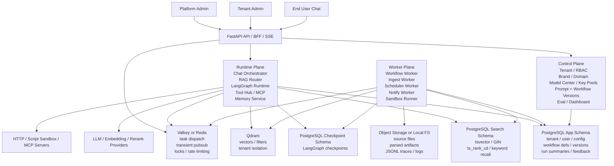

# RAGOS Architecture v1

Last updated: 2026-04-10

## 1. Executive Summary

This project should start as a `modular monolith + isolated workers`, not as a microservice fleet.

The target shape is:

- Shared Control Plane
- Shared Runtime Plane
- Tenant-Scoped Data Plane
- Thin process roles around one codebase

Compared with an early microservice split, this gives you:

- faster delivery and lower ops cost
- stronger cross-module consistency for tenant isolation
- simpler workflow compilation and runtime debugging
- a clean path to split hotspots later

The only deliberate addition to your original draft is a small internal broker layer:

- `Valkey/Redis` for task dispatch, transient pubsub, rate limiting, leases, and idempotency locks

It should not become a source of truth. Durable state still belongs in PostgreSQL, Qdrant, and object storage.

## 2. Design Principles

1. Multi-tenant first. Every request, query, file path, vector filter, secret lookup, and workflow run must resolve a `tenant_ctx` before business logic starts.
2. One codebase, multiple roles. Keep entrypoints thin and reuse the same domain modules.
3. PostgreSQL is the primary transactional store for metadata, workflow state, summaries, task envelopes, and lexical retrieval. It is not your token firehose.
4. Qdrant is tenant-scoped via payload filtering by default. Collections are organized by embedding profile, not by tenant.
5. Workflow definitions are data. Store JSON DSL, compile to LangGraph, and execute with durable checkpoints.
6. Traces are replayable. Stream live events, persist summaries in PostgreSQL, and persist detailed traces as JSONL or object storage artifacts.
7. Untrusted execution is isolated. Script and HTTP nodes are not allowed to run with platform-level trust.

## 3. Recommended Target Architecture



## 4. Runtime Roles

Use one repository with these process roles:

### 4.1 `api-server`

Responsibilities:

- public API
- platform admin API
- tenant admin API
- chat API
- SSE streaming bridge
- auth, tenant resolution, RBAC

Must stay thin:

- no heavy document parsing
- no long workflow execution
- no arbitrary script execution

### 4.2 `workflow-worker`

Responsibilities:

- LangGraph runs
- long-running tasks
- human-in-the-loop resume
- notifications and callbacks
- async tool execution that outlives the request lifecycle

### 4.3 `ingest-worker`

Responsibilities:

- document parsing and layout analysis
- OCR if needed
- semantic chunking with parent-child hierarchy
- contextual chunk enrichment (Anthropic-style)
- batch embedding generation via model gateway
- Qdrant upserts + PostgreSQL search upsert
- reindex and compaction jobs

### 4.4 `scheduler-worker`

Responsibilities:

- scheduled sync
- periodic crawling
- recurring evaluations
- retention and TTL cleanup

### 4.5 `sandbox-runner`

Responsibilities:

- script node execution
- hard resource limits
- no-network-by-default runtime

Phase 1 ships without Script node support. The sandbox-runner is required before exposing Script nodes to tenants (Phase 2). In Phase 1, the workflow engine recognizes the `Script` node type but returns a "not available on this deployment" error if invoked.

## 5. Tenant Isolation Model

In this product, "tenant independence" means logical isolation by scope, not one physical stack per tenant.

Every tenant owns its own:

- brand scope
- model bindings
- prompt and workflow versions
- knowledge bases
- conversations and memory
- secrets
- feedback and eval data

### 5.1 Canonical `tenant_ctx`

Create a canonical runtime object and inject it at the gateway boundary:

```text
tenant_ctx = {
  tenant_id,
  tenant_slug,
  brand_id,
  actor_id,
  actor_type,
  roles,
  plan_tier,
  allowed_kb_ids,
  model_binding_id,
  locale,
  timezone,
  trace_id,
}
```

### 5.2 Tenant Resolution Order

Support all three:

1. host-based resolution: `tenantA.example.com`
2. custom domain mapping: `chat.customer.com`
3. JWT or API key claim

### 5.3 Enforcement Rule

Do not rely on handler-level discipline.

Enforce tenant scoping in:

- request middleware
- repository base classes
- service constructors
- Qdrant filter builders
- file path builders
- secret resolvers
- workflow runtime bootstrap

If a repository method can query tenant-scoped data without `tenant_ctx`, that method is a bug.

In PostgreSQL, use Row-Level Security as defense in depth on high-risk tenant tables. It is a secondary guard, not a replacement for `tenant_ctx` in application code.

## 6. Data Plane

## 6.1 PostgreSQL

Use PostgreSQL for:

- tenant, user, role, permission
- brand, domain, model profile, key pool
- prompt version, workflow version, retriever profile
- knowledge base metadata
- conversation index
- structured memory facts
- run summaries
- feedback and eval cases
- task envelopes and leases

PostgreSQL's MVCC makes it well suited for concurrent control-plane writes, workflow checkpointing, queue-like tables, and lexical search.

Do not use PostgreSQL for:

- token-by-token stream logs
- high-frequency append-only event firehoses
- binary blobs
- large parsed document artifacts

### 6.1.1 Recommended PostgreSQL Layout

Start with one PostgreSQL cluster and one primary database, split into three schemas:

- `app`: control plane, tenant metadata, workflow metadata, summaries, feedback
- `search`: lexical retrieval tables and indexes for stable, hot, and memory search
- `checkpoint`: LangGraph checkpoints only

This keeps operational boundaries clear without losing transactional consistency inside one database. It also avoids PostgreSQL cross-database limitations while still letting you move `search` or `checkpoint` into separate databases later if they become noisy.

### 6.1.2 Recommended PostgreSQL Defaults

Use these defaults unless benchmarking proves otherwise:

- use a connection pooler such as PgBouncer
- default to `READ COMMITTED` for request paths; raise isolation only where business invariants require it
- use `jsonb` for flexible node config and runtime payloads, but only index stable access paths
- use `FOR UPDATE SKIP LOCKED` for queue-like task claiming
- use `CREATE INDEX CONCURRENTLY` and partition swaps for online search index maintenance
- tune autovacuum and monitor bloat on hot write tables and search partitions

Also:

- keep long transactions rare
- monitor replication lag if you add read replicas
- keep checkpoint and search maintenance observable as first-class operational signals

### 6.1.3 Indexing Rules

All tenant-scoped tables carry `tenant_id`.

All uniqueness is tenant-scoped:

- `(tenant_id, slug)`
- `(tenant_id, name)`
- `(tenant_id, external_id)`

Representative tables:

- `tenant`
- `tenant_domain`
- `user`
- `role`
- `permission`
- `tenant_brand`
- `provider`
- `key_pool`
- `model_profile`
- `tenant_model_binding`
- `prompt_def`
- `prompt_version`
- `workflow_def`
- `workflow_version`
- `retriever_profile`
- `kb`
- `document`
- `chunk_manifest`
- `conversation`
- `message_index`
- `memory_fact`
- `memory_summary`
- `run`
- `run_summary`
- `task`
- `feedback`
- `eval_case`
- `eval_run`

Recommended partitioning targets once write volume grows:

- `message_index`
- `run`
- `run_summary`
- `task`
- `search.chunk_hot`

Prefer hash partitioning by `tenant_id` for very large tenants and range partitioning by time for TTL-heavy hot data.

## 6.2 PostgreSQL Full-Text Search

Use PostgreSQL full-text search as the lexical retrieval layer in phase 1:

- low operational overhead
- language-aware parsing and weighting
- easy co-location with metadata

Recommended search features:

- `tsvector` for indexed documents
- `tsquery` for parsed queries
- `websearch_to_tsquery` for user-facing search syntax
- `setweight(...)` to weight title, headings, body, and tags differently
- `ts_rank_cd` for proximity-aware relevance ranking

Recommended search tables:

- `search.chunk_stable`
- `search.chunk_hot`
- `search.memory`

Recommended lexical search shape:

- persisted `search_vector tsvector`
- GIN index on `search_vector`
- B-tree indexes on `(tenant_id, kb_id, layer, updated_at)`
- optional trigram indexes for fuzzy title or slug lookup
- optional `ts_headline` for snippets in admin and debugger UIs

This is the default first-stage choice. It keeps lexical retrieval inside the primary database while avoiding an extra search cluster in phase 1.

## 6.3 Qdrant

Default strategy:

- organize collections by embedding profile
- isolate tenants by payload fields
- build payload indexes before bulk loading
- enable strict mode in production

Recommended collections:

- `kb_dense_bge_m3`
- `kb_dense_text3_large`
- `memory_dense_bge_m3`
- `hot_dense_bge_m3`

Recommended payload:

```json
{
  "tenant_id": "t_123",
  "kb_id": "kb_001",
  "layer": "L1",
  "doc_id": "doc_456",
  "chunk_id": "chk_789",
  "parent_chunk_id": "chk_780",
  "is_parent": false,
  "source_type": "upload",
  "lang": "zh",
  "tags": ["policy", "hr"],
  "updated_at": 1712700000,
  "security_level": "internal",
  "ttl_at": null
}
```

Note: `updated_at` and `ttl_at` use integer Unix timestamps. Qdrant range filtering on integers is significantly faster than on ISO strings. `parent_chunk_id` and `is_parent` support the parent-child chunk hierarchy described in section 7.4.

Priority payload indexes:

- `tenant_id` (keyword)
- `kb_id` (keyword)
- `layer` (keyword)
- `lang` (keyword)
- `is_parent` (bool)
- `updated_at` (integer range)
- `security_level` (keyword)
- `ttl_at` (integer range)

Use `tags` indexes only when filter frequency justifies it.

### 6.3.1 Multitenancy Rule

Do not create one collection per tenant.

Default rule:

- one collection per embedding model or retrieval profile
- tenant isolation via payload filters

### 6.3.2 Tiered Multitenancy Trigger

When a tenant becomes large enough to create noisy-neighbor risk, promote it to a dedicated shard inside the same collection.

Recommended promotion triggers:

- more than about 20K points in a hot collection
- sustained noisy-neighbor latency
- dedicated data residency or isolation requirement

### 6.3.3 Future Option: Native Hybrid in Qdrant

Qdrant now supports dense, sparse, hybrid, and reranking pipelines in one engine.

Still, for phase 1 I recommend:

- lexical retrieval in PostgreSQL FTS
- dense retrieval in Qdrant
- application-side fusion and rerank

Reason:

- simpler to ship
- easier to debug
- fewer moving parts for the first commercial version

If evaluation later shows clear gains, phase 2 can move lexical or hybrid fusion deeper into Qdrant.

## 6.4 File and Object Storage

Store these outside PostgreSQL:

- original uploads
- images
- OCR outputs
- parsed markdown or JSON
- chunk manifests
- workflow trace JSONL
- exported reports

Use tenant-scoped paths:

```text
/{tenant_id}/{kb_id}/{doc_id}/{version}/...
/{tenant_id}/runs/{run_id}/trace.jsonl
/{tenant_id}/runs/{run_id}/artifacts/...
```

## 6.5 Valkey or Redis

This is the smallest infrastructure addition I strongly recommend.

Use it for:

- task dispatch
- transient event pubsub for SSE fan-out
- leases and worker heartbeats
- idempotency locks
- rate limiting
- short-lived caches

Do not use it as:

- the durable system of record
- the only place a task exists
- the only place workflow events exist

Recommended pattern:

1. durable task row in PostgreSQL
2. transient queue notification in Valkey/Redis
3. worker claims the task with a lease inside a database transaction
4. worker writes summary to PostgreSQL and detailed trace to JSONL/object storage

PostgreSQL also provides `LISTEN` / `NOTIFY`, but use that only for low-volume wakeups or control-plane signals. Keep Redis as the primary transient fan-out path for workers and SSE.

This uses PostgreSQL for durability and coordination without turning it into a token-stream backbone.

## 7. Knowledge and Memory Architecture

## 7.1 Three Logical Layers

Keep the three-layer model:

- `L1`: stable authoritative knowledge
- `L2`: incrementally updated knowledge
- `L3`: hot and temporary knowledge

## 7.2 Two Physical Tiers

Implement as:

- stable tier: `L1 + L2`
- hot tier: `L3`

Reason:

- `L3` has different write cadence
- `L3` needs TTL and faster invalidation
- `L3` should not force heavy rebuilds on the stable tier

## 7.3 Long-Term Memory

Do not merge long-term memory into the enterprise knowledge base.

Enterprise knowledge answers "what the organization knows".
Long-term memory answers "what this actor prefers, did, or already established".

### Three-Tier Memory Model (MemGPT-inspired)

| Tier | Storage | Content | Lifecycle |
|------|---------|---------|-----------|
| Working Memory | In-graph state | Current system prompt, active tool results, scratchpad | Per-run, discarded on completion |
| Conversation Buffer | PostgreSQL `message_index` | Recent N turns verbatim; older turns as rolling summaries | Per-conversation, summarized on overflow |
| Long-term Memory | PostgreSQL `memory_fact` + Qdrant `memory_vector` | Extracted facts, user preferences, behavioral patterns | Cross-conversation, with decay scoring |

### Fact Extraction

After each conversation (or periodically), run an LLM extraction pass to produce structured facts:

```json
{
  "fact": "User prefers responses in Traditional Chinese",
  "category": "preference",
  "confidence": 0.95,
  "source_conversation_id": "conv_abc",
  "extracted_at": "2026-04-10T12:00:00Z"
}
```

Facts are stored in `memory_fact` (PostgreSQL) with a `decay_score` that decreases over time and resets on access. Low-decay facts are candidates for archival or deletion.

### Conversation Summarization

Use rolling summaries to compress conversation history:

1. Keep the most recent N turns verbatim in the context window
2. Summarize older turns into a paragraph stored in `memory_summary`
3. On new sessions, load the summary + recent facts as conversation context

This keeps context window usage bounded while preserving continuity.

### Memory Recall During RAG

The memory service provides relevant facts and summaries as a separate context section in the generation prompt, clearly distinguished from KB retrieval results. Do not mix memory and KB results in the same evidence block.

## 7.4 Ingestion Pipeline

```text
Source Document
  -> Parser (layout analysis: text, tables, images)
  -> Chunker (semantic splitting + parent-child hierarchy)
  -> Enricher (contextual chunking)
  -> Embedder (batch, provider-agnostic)
  -> Indexer (Qdrant upsert + PostgreSQL search upsert)
```

### Contextual Chunking (Anthropic-style)

Before embedding, prepend an LLM-generated document-level context summary to each chunk. This dramatically improves retrieval relevance because the embedding captures both chunk-level detail and document-level meaning.

Implementation:

1. Parse the full document
2. Generate a 2-3 sentence document context summary (cache this per document)
3. For each chunk, prepend: `"[Document context: {summary}]\n\n{chunk_text}"`
4. Embed the enriched chunk
5. Store original chunk text separately for display (do not show the prepended context to the user)

Use prompt caching to reduce cost when processing many chunks from the same document.

This is configurable per KB — cost-sensitive tenants can disable enrichment and use raw chunks.

### Parent-Child Chunk Hierarchy

Use small child chunks (256-512 tokens) for precise retrieval matching, but expand to the parent chunk (1024-2048 tokens) when building the LLM context window.

Implementation:

- During chunking, assign each child chunk a `parent_chunk_id`
- Store both parent and child chunks in Qdrant
- During retrieval, match on child chunks for precision
- After fusion/rerank, expand selected children to their parents for the generation context
- Deduplicate overlapping parents

This gives the best balance of retrieval precision and generation context completeness.

## 8. Retrieval Pipeline

Recommended retrieval chain:

```text
user query
-> normalize / rewrite
-> intent classify + query decomposition
-> route by tenant profile
-> multi-source recall (parallel)
-> fusion
-> rerank
-> relevance gate (CRAG)
-> answer generation + citation linking
-> self-consistency check
-> memory writeback (fact extraction)
```

### 8.1 Query Engine

Support multiple query strategies, selected by intent classification:

- **Direct retrieval**: standard query rewrite and multi-source recall
- **HyDE (Hypothetical Document Embedding)**: generate a hypothetical answer, embed that instead of the query — useful for short/vague queries
- **Query decomposition**: break complex multi-part questions into sub-queries, retrieve independently, merge results
- **Agentic RAG**: the LLM decides when and how to retrieve, can re-query with different parameters, filter, or route to different sources dynamically. Use this for complex reasoning tasks. Implement as a LangGraph subgraph with retrieval tools.

Default to direct retrieval. Enable HyDE and agentic modes per tenant profile or workflow node configuration.

### 8.2 Recall Channels

Minimum recall channels:

1. PostgreSQL FTS (lexical)
2. Dense vector recall (semantic)
3. KB-filtered recall (scoped to specific KBs)
4. Long-term memory recall (facts + vector)
5. Hot-tier recall (L3, with freshness priority)
6. Web search recall (optional, configurable)

### 8.3 Fusion

Recommended fusion controls:

- RRF (Reciprocal Rank Fusion) — default, robust
- Weighted score fusion — when one source is known stronger
- Layer boost: `L3 > L2 > L1`
- Freshness boost — decay by `updated_at`
- Authority boost — official docs score higher

Fusion strategy is configurable per retriever profile.

### 8.4 Relevance Gate (CRAG Pattern)

After reranking and before generation, run a lightweight relevance grading step:

1. A fast LLM (or the same model with a short prompt) grades whether the top-K retrieved chunks are sufficient to answer the query
2. Grade categories: `relevant`, `ambiguous`, `irrelevant`
3. If `relevant` → proceed to generation
4. If `ambiguous` → re-retrieve with rewritten query, then proceed
5. If `irrelevant` → fall back to web search or return "I don't have enough information" with high confidence

This is a high-impact, low-cost addition that significantly reduces hallucination from poor retrievals.

### 8.5 Output Policy

- Oversample candidates upstream (e.g., top 50 from recall)
- Rerank a smaller set (e.g., top 20)
- Grade relevance on the reranked set
- Only pass top `K` evidence chunks into generation (e.g., top 5-8)
- Expand child chunks to parent chunks for richer context (see 7.4)
- Keep citations as first-class runtime state — structured, not inline text

## 9. Workflow Architecture

LangGraph should be the workflow runtime kernel.

## 9.1 Four-Layer Workflow Stack

### A. Workflow DSL

Persist JSON DSL, not Python source code.

The DSL contains:

- nodes
- edges
- input and output schemas
- condition expressions
- retry and timeout policies
- exception policies
- secret references
- permission requirements

### B. Compiler

Compile DSL to LangGraph and cache by `workflow_version`.

Compiler output includes:

- executable graph
- node capability manifest
- input validation schema
- event schema

### C. Runtime

Each execution should bootstrap a typed shared state:

```text
tenant_ctx
run_ctx
user_input
messages
variables
retrieved_docs
tool_results
citations
errors
checkpoints
```

### D. Event Stream

Emit a unified event model:

- `run_started`
- `node_started`
- `retrieval_completed`
- `rerank_completed`
- `relevance_graded`
- `tool_called`
- `tool_finished`
- `token_delta`
- `citation_linked`
- `memory_updated`
- `interrupt_requested`
- `node_finished`
- `run_finished`
- `run_failed`

Every event must have:

- `event_id`
- `run_id`
- `tenant_id`
- `ts`
- `node_id`
- `event_type`
- `payload`

This event contract powers both:

- end-user SSE
- developer trace and debugger UI

## 9.2 LangGraph-Specific Rules

Use these defaults:

- enable persistence with a durable checkpointer
- use `PostgresSaver` or `AsyncPostgresSaver` in every non-test deployment
- call `checkpointer.setup()` during worker startup
- require `thread_id` on resumable runs
- wrap side effects in tasks
- keep operations deterministic and idempotent

Recommended durability defaults:

- `async` for most chat and workflow runs
- `sync` for approval, money movement, or irreversible side effects
- `exit` only for best-effort internal flows

Subgraph rule:

- prefer per-invocation subgraphs by default
- only use per-thread subgraphs when memory across turns is required
- if you use per-thread subgraphs, explicitly prevent parallel calls to the same subgraph namespace

### 9.2.1 Thread ID Scoping

Generate tenant-scoped thread IDs for checkpointer isolation:

```text
{tenant_id}:{workflow_id}:{run_id}
```

Pass `tenant_id` and other context via the LangGraph config's `configurable` dict. Never store tenant data in global or module-level state.

### 9.2.2 Streaming

Use `astream_events(version="v2")` for granular event streaming (LLM tokens, node start/end, tool calls). Filter by `event["kind"]` and `event["name"]` before forwarding to SSE.

For simpler consumers that only need node-level output deltas, use `astream(stream_mode="updates")`.

### 9.2.3 Human-in-the-Loop

Use `interrupt_before` or `interrupt_after` on designated nodes at compile time. To resume after human input:

1. Checkpoint state is persisted automatically
2. Use `Command(resume=value)` API to pass user input back
3. Re-invoke the graph with the same `thread_id` and `None` input

### 9.2.4 Node Error Handling

Use `RetryPolicy` at the node level:

```python
graph.add_node("n", fn, retry=RetryPolicy(max_attempts=3))
```

For finer control, catch exceptions inside node functions and write error info to state. Use conditional edges to route to fallback paths. Add a dedicated `error_handler` node as a catch-all terminal.

Set `retry_on` to target specific exception types (e.g., rate limit, timeout) rather than retrying all failures.

### 9.2.5 Custom Node Registry

Use a registry pattern to map DSL node types to handler functions:

```python
NODE_REGISTRY = {
    "llm": llm_node_fn,
    "retrieve": retrieve_node_fn,
    "http": http_node_fn,
    "script": script_node_fn,
    ...
}
```

The compiler looks up each DSL node's `type`, grabs the corresponding function, and wraps it with node-specific config via `functools.partial`. This keeps the compiler generic and node implementations independent.

## 9.3 Node Taxonomy

Fix the public node taxonomy early:

- `LLM`
- `Retrieve`
- `Condition`
- `Loop`
- `HTTP`
- `Script`
- `MCPTool`
- `Notify`
- `Subflow`

Avoid turning "anything" into a node type. That makes governance impossible later.

## 10. Streaming and Event Replay

FastAPI now has native SSE support, so the platform can standardize on SSE for chat and debugger streams.

Recommended streaming design:

1. worker emits runtime events
2. API subscribes to transient pubsub
3. SSE endpoint forwards events with monotonic `event_id`
4. client reconnects with `Last-Event-ID`
5. API backfills missed events from JSONL trace or checkpoint snapshot

This gives you:

- browser-native streaming
- reconnect support
- unified chat and debugging transport

Detailed traces belong in JSONL or object storage, not in PostgreSQL row-by-row token tables.

## 11. Tooling and Execution Safety

### 11.0 Rate Limiting

Enforce per-tenant rate limits at the API gateway layer using Valkey/Redis.

Model:

- **Token bucket** per tenant, per endpoint class (chat, ingest, admin)
- Bucket size and refill rate derived from `plan_tier` in `tenant_ctx`
- Separate limits for LLM token consumption (daily/monthly quota tracked in `run_summary` aggregation)
- Return `429 Too Many Requests` with `Retry-After` header on exhaustion

Implementation:

- Rate limit check runs as FastAPI middleware, after tenant resolution
- Valkey `INCR` + `EXPIRE` for simple counters; sliding window log for burst-sensitive endpoints
- LLM token quotas are checked pre-generation and updated post-generation (optimistic with reconciliation)

### 11.1 HTTP Nodes

Must support:

- allowlist or policy-based outbound domains
- secret alias injection
- request timeout
- retry policy
- idempotency key support
- SSRF protection
- audit log
- response schema validation

## 11.2 Script Nodes

Never `exec` inside the FastAPI process or the worker main runtime.

Minimum isolation requirements:

- wall-clock timeout
- CPU limit
- memory limit
- import allowlist
- filesystem isolation
- no network by default
- stdout and stderr capture
- return schema validation

## 11.3 MCP Integration

Treat MCP as the tool abstraction layer for:

- tool discovery
- resource discovery
- prompt templates
- remote context providers

This matches current ecosystem direction and keeps the Tool Hub decoupled from any single vendor SDK.

## 12. Model Center and Key Pool

Model routing should use four explicit objects:

1. `provider`
2. `key_pool`
3. `model_profile`
4. `tenant_binding`

`model_profile` should encapsulate:

- use case
- model name
- parameters
- fallback chain
- cost class
- rate class
- streaming capability

At runtime, support overrides in this order:

1. platform safety policy
2. workflow node override
3. tenant default binding
4. provider fallback

Persist the exact resolved model configuration for every run.

## 13. Observability and Evaluation

Do not reduce observability to logs only.

Use four operational views:

### 13.1 Retrieval Explain

Show:

- rewritten query
- filters
- per-channel recall
- fusion scores
- rerank order
- final cited chunks

### 13.2 Workflow Trace

Show:

- graph path
- node input and output summaries
- tool calls
- retries
- interrupts
- failures

### 13.3 Evaluation Lab

Version these together as a reproducible experiment bundle:

- `prompt_version`
- `workflow_version`
- `model_profile_version`
- `retriever_profile_version`
- `parser_version`
- `chunker_version`

Use RAGAS as the default metric framework:

- **Faithfulness**: is the answer grounded in the retrieved context?
- **Answer Relevancy**: does the answer address the question?
- **Context Precision**: are the retrieved chunks relevant?
- **Context Recall**: did retrieval find all necessary information?

Supplement with LLM-as-judge for subjective quality assessment. Use structured rubrics with few-shot examples to reduce scoring variance.

Run eval automatically on every retrieval pipeline or prompt change. Store results in `eval_run` with the full bundle snapshot for reproducibility.

### 13.4 Feedback Loop

Feed these back into eval data:

- thumbs up or down
- user corrections
- human review outcome
- export actions
- escalation labels

### 13.5 Process Reasoning Policy

Expose:

- evidence summary
- retrieval explanation
- tool execution summary

Do not expose raw private chain-of-thought.

### 13.6 OpenTelemetry Integration

Instrument all LLM calls, retrieval operations, reranking, and tool invocations as OpenTelemetry spans following the GenAI semantic conventions.

Required span attributes:

- `gen_ai.system`, `gen_ai.request.model`
- `gen_ai.usage.input_tokens`, `gen_ai.usage.output_tokens`
- `rag.query.original`, `rag.query.rewritten`
- `rag.retrieval.source`, `rag.retrieval.count`
- `tenant.id`, `run.id`, `workflow.version`

Trace the full request lifecycle (query → retrieval → rerank → grading → generation) as a single trace with child spans. Export to any OTel-compatible backend (Jaeger, Grafana Tempo, etc.).

Phase 1 can start with structured logging. Phase 2 adds full OTel instrumentation.

## 14. Delivery Roadmap

## Phase 1: Sellable Single-Host Foundation

Deploy on one host:

- FastAPI
- workers
- PostgreSQL
- Qdrant single node
- object storage or local disk
- Valkey/Redis recommended

Ship:

- multi-tenant auth and branding
- KB ingest with contextual chunking and parent-child hierarchy
- chat with citations and CRAG relevance gate
- workflow DSL v1
- SSE streams
- three-tier memory (working + buffer + long-term with fact extraction)
- basic evaluation bundle (RAGAS metrics)

## Phase 2: Operational Hardening

Add:

- sandbox runner
- better quotas and rate limits
- richer eval suite
- Qdrant tiered multitenancy for large tenants
- object storage lifecycle policies
- OpenTelemetry and dashboards

## Phase 3: Scale-Out Triggers

Split PostgreSQL responsibilities when one of these becomes true:

- checkpoint writes measurably hurt request-path latency
- search index maintenance or autovacuum on hot partitions becomes noisy
- queue-like task mutation volume starts competing with control-plane traffic
- you need HA, read replicas, or region-specific placement beyond a single primary

At that point:

- move `checkpoint` to a dedicated PostgreSQL database or cluster
- move `search` to a dedicated PostgreSQL database if lexical indexing becomes operationally heavy
- add replicas and poolers before introducing more services
- keep Qdrant and workers unchanged

## 15. Proposed Monorepo Layout

```text
apps/
  api-server/src/ragos_api/
  workflow-worker/src/ragos_workflow_worker/
  ingest-worker/src/ragos_ingest_worker/
  scheduler-worker/src/ragos_scheduler_worker/
  sandbox-runner/src/ragos_sandbox_runner/
  web/

packages/
  core/src/ragos/core/
  auth/src/ragos/auth/
  tenant/src/ragos/tenant/
  control-plane/src/ragos/control_plane/
  runtime/src/ragos/runtime/
  retrieval/src/ragos/retrieval/
  memory/src/ragos/memory/
  model-gateway/src/ragos/model_gateway/
  toolhub/src/ragos/toolhub/
  sandbox/src/ragos/sandbox/
  storage/src/ragos/storage/
  observability/src/ragos/observability/

infra/
  docker/
  scripts/
  migrations/

docs/
  architecture.md
  adr/
```

Rule:

- use `src` layout consistently; filesystem directory names may be kebab-case, but Python imports come from the package under `src/`

- entrypoints live in `apps/`
- reusable business logic lives in `packages/`
- infra and environment bootstrap stay outside domain code

## 16. Final Recommendation

The final recommendation is:

`Shared Control Plane + Shared Runtime Plane + Tenant-Scoped Data Plane`

With these concrete choices:

- FastAPI for API, BFF, and SSE
- LangGraph for stateful workflow runtime
- PostgreSQL for control plane metadata, summaries, tasks, checkpoints, and full-text search
- Qdrant for vector retrieval with payload-based multitenancy
- Valkey/Redis for dispatch, locks, and transient stream fan-out
- object storage or local FS for source files and detailed traces
- isolated sandbox runner for Script nodes
- model gateway with provider, key pool, profile, and fallback
- versioned experiment bundles for replay, debugging, and evaluation

This is the highest-leverage architecture for the current product stage:

- simple enough to ship
- strong enough to sell
- structured enough to customize
- disciplined enough to scale later

## 17. References

Validated against official documentation on 2026-04-10:

- [LangGraph Persistence](https://docs.langchain.com/oss/python/langgraph/persistence)
- [LangGraph Durable Execution](https://docs.langchain.com/oss/python/langgraph/durable-execution)
- [LangGraph Streaming](https://docs.langchain.com/oss/python/langgraph/streaming)
- [LangGraph Subgraphs](https://docs.langchain.com/oss/python/langgraph/use-subgraphs)
- [FastAPI Server-Sent Events](https://fastapi.tiangolo.com/tutorial/server-sent-events/)
- [FastAPI Background Tasks Caveat](https://fastapi.tiangolo.com/tutorial/background-tasks/)
- [PostgreSQL MVCC](https://www.postgresql.org/docs/current/mvcc-intro.html)
- [PostgreSQL Row Security Policies](https://www.postgresql.org/docs/current/ddl-rowsecurity.html)
- [PostgreSQL Full Text Search Introduction](https://www.postgresql.org/docs/current/textsearch-intro.html)
- [PostgreSQL Text Search Controls](https://www.postgresql.org/docs/current/textsearch-controls.html)
- [PostgreSQL NOTIFY](https://www.postgresql.org/docs/current/sql-notify.html)
- [Qdrant Multitenancy](https://qdrant.tech/documentation/manage-data/multitenancy/)
- [Qdrant Fundamentals FAQ](https://qdrant.tech/documentation/faq/qdrant-fundamentals/)
- [Qdrant Overview and Strict Mode](https://qdrant.tech/documentation/overview/)
- [Qdrant Search Overview](https://qdrant.tech/documentation/search/)
- [Model Context Protocol Architecture](https://modelcontextprotocol.io/docs/learn/architecture)
