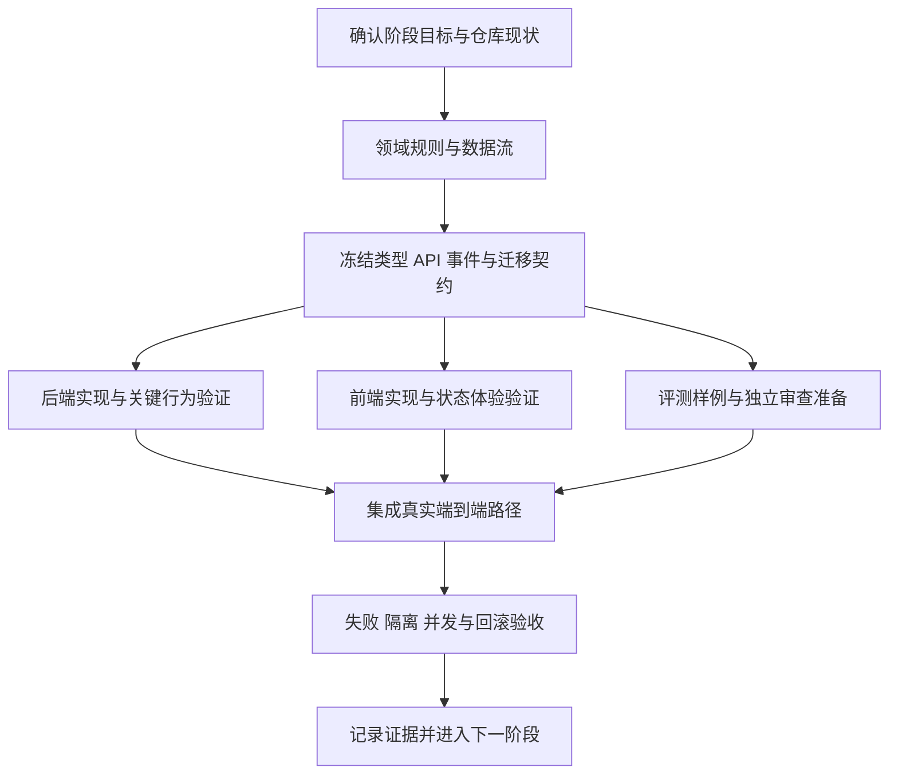

# 多 Agent 开发规范

适用范围：本仓库的设计、代码、测试、文档与交付协作。制定日期：2026-10-09。

本规范约束未来变更的组织方式，不代表仓库已经满足这些要求。阶段与验收条件见 [开发路线图](development-roadmap.md)，工程约束见 [开发约束](development-constraints.md)。[架构文档](architecture.md) 是架构约束的权威来源，[领域词汇表](../GLOSSARY.md) 是共享业务语义的事实源。发现文档与代码矛盾时，先记录差异并由契约负责人裁决；不得用新抽象或兼容分支掩盖差异。

## 1. 先建立边界，再分配并行任务

每个变更先回答四件事：解决哪个业务问题、谁拥有数据、数据如何流动、成功与失败如何呈现。只有这些问题明确后，才拆给多个 Agent。

协调者在派工前提交最小设计记录，至少包括：

- 领域对象及不变量：复用哪些现有概念，哪些概念确实需要新增。
- 模块边界：公开接口、输入输出、依赖方向、内部隐藏的信息。
- 数据流：鉴权入口 → 服务 → 仓储或模型网关 → 持久状态或事件 → API → 前端；标明可信身份来源、异步边界和副作用。
- 失败流：拒绝、超时、取消、重复执行、部分完成的结果及恢复方式。
- 用户流程：用户从哪个页面入口进入，如何看到处理中、结果、引用、错误和可采取的下一步。
- 删除清单：哪些旧类型、接口、配置、调用方和测试随本次变更一起移除。

结构性决策先更新架构文档并完成评审，再派发实现任务。现有服务边界足以解决问题时，不新增微服务、通用插件层、万能基类或第二套身份机制。

## 2. 角色按任务需要设置

角色表示责任，不表示固定人数。一个 Agent 可以承担多个低冲突角色；涉及隔离、训练晋升或不可逆迁移时，作者与最终审查者应由不同 Agent 承担。仅启动任务所需的角色。

| 角色 | 责任 | 必须交付 |
| --- | --- | --- |
| 协调者 / 集成负责人 | 选择阶段、维护依赖图和文件所有权、控制范围、组织集成和验收 | 任务合同、所有权表、集成结果、未完成事项 |
| 架构 / 契约负责人 | 明确模块边界、冻结共享类型、API、事件和迁移设计，裁决契约冲突 | 不变量、契约版本、数据流、变更影响清单 |
| 领域负责人 | 确定业务词汇、状态机、身份与资源归属、错误语义 | 领域对象和规则，词汇表及必要架构更新 |
| 后端负责人 | 在既定契约下实现服务、仓储、网关和 worker 行为 | 实现、关键行为验证、故障恢复证据 |
| 前端负责人 | 贯通实际 API 和事件，维护交互、可访问性和各状态体验 | 完整用户路径、真实契约集成、界面验证证据 |
| 算法 / 评测负责人 | 建立 baseline，隔离训练与评测数据，组织可复现实验 | 数据清单、版本快照、原始结果、结论适用范围 |
| 独立审查者 | 检查领域边界、安全、并发、失败流、前端回归及证据真实性 | 可执行问题清单、风险裁决、合并意见 |

契约负责人不得仅提供函数名。身份上下文、共享资源授权、引用验证状态、任务终态、失败码和前端展示含义都属于契约。前端负责人不得自行创造一套后端未定义的业务状态；算法负责人不得为了跑通脚本绕过身份、版本或模型网关边界。

## 3. 工作区与文件所有权

### 3.1 单文件单写者

协调者维护以下所有权表。每个可写文件或无重叠目录在同一时间只有一个写者；其他 Agent 可以读取和评审。

| 文件或目录 | 唯一写者 | 基础提交 | 所依赖契约版本 | 状态 |
| --- | --- | --- | --- | --- |
| 精确路径或无重叠目录 | Agent 名称 | commit SHA | 版本或摘要 | 未开始 / 编写中 / 待评审 / 已集成 |

规则：

1. 派工前检查工作树及未提交改动，记录基础提交。已有改动先识别归属，不据此推断可以覆盖。
2. 文件范围发生重叠时先拆分或串行处理，不让两个 Agent 通过轮流保存同一文件协作。
3. 需要修改未拥有文件时，报告契约差异和建议补丁，由写者处理，或由协调者显式移交所有权。
4. 移交必须确认旧写者停止写入，并记录当前内容与待办。协调者不能在旧写者仍运行时直接接管。
5. 禁止以整体重写、工作树重置、清理未跟踪文件、删除目录或覆盖复制来解决并行冲突。
6. 不改格式无关的文件，不顺手重构相邻模块，不撤销其他 Agent 或用户的改动。

### 3.2 共享契约冻结

以下内容必须由指定负责人串行修改并先冻结，再允许依赖实现并行展开：

- 核心身份上下文、scope 派生规则、资源授权与跨租户管理接口。
- 共享领域类型、状态枚举、领域异常、模型网关协议、检索与引用对象。
- API schema、SSE 事件 schema、前端生成的类型或客户端。
- 数据库迁移、Qdrant payload 与索引版本、训练数据和模型产物 manifest。
- 根依赖声明、锁文件、统一测试配置、构建配置。

冻结记录包括字段、版本、不变量、错误语义、调用方与数据迁移影响。冻结后需要变更时，由契约负责人发布新版本及受影响任务清单；依赖 Agent 先停下相关实现，完成同步后再继续。不得各自增加可选字段、默认值、类型别名或适配器来绕开冻结契约。

### 3.3 共享 checkout 与隔离 worktree

共享 checkout 适合范围小、文件互不重叠、契约已冻结的任务。写者仍按文件分配；有副作用的验证、迁移、服务启动和依赖安装由协调者安排唯一执行者，防止同时占用端口、写相同测试库或改锁文件。

隔离 worktree 适合独立实现、验证会改工作区、较长任务或需要独立提交的情况。各任务基于明确的提交与契约版本；集成负责人按依赖顺序合并并解决冲突。worktree 隔离的是文件，不会自动隔离数据库、缓存、文件存储、外部凭据或 GPU；测试资源还需独立命名与明确归属。

无论采用哪种方式，都不得删除或归档含有其他工作、未提交改动或未确认产物的工作区。迁移顺序和共享契约所有权仍需统一，不能靠分支名避免冲突。

## 4. 有限任务合同

每个 Agent 接到一个可独立审查的有限任务。合同记录在已有任务记录、PR 描述或本地协作记录中，不引入新的运行时调度框架。

```text
任务 ID / 所属阶段：
目标：用户或系统的哪一项行为会改变？
完成条件：能观察到的结果及其验收方式。
不在范围内：明确排除的功能、重构与外部操作。
负责人 / 审查者：
基础提交 / 工作区：
允许写入的精确文件或无重叠目录：
只读参考文件：
前置任务及其交付版本：
冻结契约：身份、类型、API、事件、状态机、迁移及版本。
领域不变量 / 数据流 / 安全边界：
并发与故障：重复、竞态、重试、超时、取消、部分完成。
前端影响：入口、用户状态、交互、错误及恢复。
验证：命令或操作步骤、所需环境、预期结果、证据位置。
可观测性：运行标识、事件、摘要、敏感信息脱敏。
回滚：代码、配置、索引、模型及持久数据各如何恢复。
删除项 / 调用方同步项：
授权与资源上限：本地操作、外部服务、费用、数据与凭据范围。
阻塞报告：缺少什么、最小解决方式、已完成哪些独立工作。
```

目标应是“上传文档后可查询持久状态并打开引用”，而不是“完善 RAG 模块”。验证应是具体行为，不能写成“所有测试通过”而不说明覆盖内容与环境。

发现范围扩大、共享契约冲突、权限缺失、数据归属不明或验证环境不可用时，报告给协调者并继续不受影响的工作。不能自行降低安全要求、创建公网服务、读取额外租户数据、购买算力、扩大凭据权限、发布部署或清空数据库来解除阻塞。授权已明确的本地检查和修复按合同继续，不反复要求批准同一动作。

## 5. 依赖图与阶段门槛

先派发契约与领域梳理，再并行实现互不重叠的生产者和消费者。并行数量由独立任务数决定。



阶段顺序遵循开发路线图：修复可运行性 → 打通真实 RAG → 修正评测与身份边界 → 实现 SFT → GRPO 对照实验 → 产品与运维扩展。

- 隔离底线和前端体验贯穿各阶段，不能等到“身份边界”阶段才执行授权，或等到“产品”阶段才处理失败界面。
- 在可测 baseline 与真实链路形成前，可准备数据契约和实验设计，不能把奖励函数、样例脚本或 mock 输出当作训练成果。
- SFT 必须依赖冻结的数据划分与评测契约。GRPO 必须依赖可复现的 SFT 产物与独立对照；训练优化、dev 调参、holdout 晋升评测的边界按开发约束执行。
- 下一阶段可以进行不改变当前默认行为的只读分析和设计准备；生产行为的切换必须等前置阶段验收。
- 任务依赖未完成时标记阻塞；不得通过临时假接口、全局状态、占位成功响应或宽泛异常吞掉依赖问题。

## 6. 模块设计与共享业务语义

代码评审先检查领域不变量和依赖方向，再检查局部实现。优雅的模块应通过小而完整的接口隐藏复杂度，让调用方不必了解存储结构、供应商差异或恢复细节。

1. 一个业务规则有一个权威实现。租户解析、资源归属、状态转换、权限判定、引用验证、费用归属不得在 API、worker 和前端分别实现。
2. 入口负责协议适配，服务负责用例，仓储负责受控数据访问；前端只表达契约中的业务结果。
3. 共享领域类型描述业务含义。HTTP DTO、数据库行、供应商 SDK 对象只在边界转换，不直接泄漏给其他模块。
4. 复用稳定的业务语义，不追求把相似代码强行抽成通用工具。新抽象必须有实际调用方、明确的隐藏复杂度和稳定接口。
5. 拆模块按数据所有权和变化原因，不按 Agent 人数拆包。禁止为让任务“可并行”而创建第二套网关、仓储或状态机。
6. 删除过时路径比长期兼容更优。破坏性变更先列出全部调用方、已有数据和回滚影响；不能以删除持久数据来掩盖迁移失败。

## 7. 并发与故障作为契约的一部分

异步和可重试任务在开工前必须定义持久状态、合法转换、唯一键或幂等键、租约归属、超时、取消、重试范围及重复完成的处理方式。业务成功以持久提交为准，队列通知和前端连接状态不作为成功证据。

涉及并发的任务至少明确并验证适用场景：

| 场景 | 合同必须回答 |
| --- | --- |
| 两个 worker 领取同一任务 | 谁取得有效租约，旧持有者如何被阻止写入 |
| 写入完成后进程退出、通知未发送 | 如何恢复并补发，重复通知是否安全 |
| PostgreSQL 与 Qdrant 仅一侧写入成功 | 如何保留 manifest、重试或补偿，何时允许检索 |
| 用户重复提交或网络重发 | 如何识别同一业务操作，如何返回已存在结果 |
| SSE 重连、乱序或重复事件 | 如何去重、补齐、终结流，避免重复内容和无限加载 |
| 切换租户、页面离开或旧请求迟到 | 如何取消旧请求并防止旧结果进入新页面或新缓存 |
| 模型超时、配额不足、部分失败 | 如何停止副作用、记录失败、向用户提供可执行下一步 |

重试仅用于明确的瞬时失败，必须有次数和总时间上限。权限错误、schema 错误和业务冲突不靠重试解决。故障降级必须保持隔离与结果真实性；未索引、未验证、未训练的结果不能伪装成成功。

## 8. 前后端按一个完整变更交付

schema、API 和 UI 的破坏性变更必须在同一交付单元内同步：数据库或索引迁移 → 服务行为 → API 与事件契约 → 客户端类型 → 页面逻辑 → 验证与文档。可以分 Agent 编写，但不能把半套契约作为可发布版本合并。需要在线迁移窗口时，由架构负责人给出有期限的迁移协议；不留下无限期兼容入口。

前端验收覆盖受影响用户路径中的初始、加载、空结果、成功、部分失败、权限不足、超时、重试、取消、重连和终态。并非每个页面都需要全部状态；合同必须说明哪些适用以及其呈现方式。

- 入口、按钮和路由指向真实能力；未启用能力清楚显示不可用原因，不展示可点击后必然失败的正常操作。
- 后端返回明确的错误码与状态，前端提供对应反馈和恢复动作；不以静默 fallback 或假数据掩盖服务失败。
- 引用的页码、原文定位和验证状态贯通 API 与展示，用户能区分已验证与未验证结果。
- 隔离缓存、请求和事件订阅，切换租户后不残留前一租户的数据。
- 不因局部功能变更破坏键盘操作、焦点、移动端布局、历史会话和现有核心流程。
- mock 可用于开发和确定性测试，记录其范围；核心交付必须通过真实接口验证，不能只提交截图或静态页面。

## 9. 交接与集成

Agent 停止任务前提交以下交接，不用“已完成”代替证据：

```text
任务 ID / 基础提交 / 最终提交或改动位置：
结果：实际改变了什么行为？
修改与删除文件：仅列本人负责范围。
契约：使用哪个版本，有无偏离或新增需求？
验证：命令或步骤、环境、结果与原始证据位置。
证据边界：真实服务 / mock / 静态检查 / 未执行分别标明。
并发、隔离和前端状态：验证了什么，尚缺什么？
观察与回滚：可定位标识、可用恢复步骤及限制。
未完成项与阻塞：影响、负责人建议、下一步。
给下游：消费方式、配置要求、迁移顺序与易错点。
```

协调者按依赖顺序集成，先契约与迁移，再实现与消费者；集成后重新检查整个 diff 和工作树，确认没有覆盖其他工作、引入无关文件或保留过时调用方。不同 Agent 的“通过”不能相加成集成通过。

合并前检查：

1. 领域与架构：边界明确、共享语义一致、没有越层访问及重复模式。
2. 安全与隔离：身份可信派生，资源授权明确，负向探测覆盖受影响路径，敏感信息未进入代码、日志或 UI。
3. 并发与故障：关键不变量、幂等、租约、超时、部分提交及恢复经过适当验证。
4. 前端：受影响核心路径接通真实服务，状态完整、旧结果无串入、回归检查有证据。
5. 算法：检索或生成质量变更使用冻结评测；训练有真实优化、产物与读回证据，晋升有独立对照和回退配置。
6. 可观测性：trace 或 run 标识可关联状态、事件、模型配置与错误；汇总和深度产物放在架构指定位置。
7. 回滚：说明代码、配置、模型、索引及数据恢复边界；不可逆数据变更有独立方案，不能声称 Git 回退能恢复数据库。
8. 上下文与删除：更新受影响契约、领域词汇和设计原因，删除弃用路径及依赖，不留下无期限兼容债务。

验证按风险选择，执行一次必要检查后不机械重复扩展；新失败或新改动再补验证。文档与格式检查只能证明文档与格式；mock 测试不能证明真实数据库、模型服务或隔离成立；测试项数量与退出码不能证明训练收益、线上稳定性或生产准备度。

## 10. 为未来维护者保留上下文

设计记录说明为什么采用当前边界、拒绝了哪些实际候选、有哪些约束及何时需要重新评估。代码注释说明业务不变量和不明显的取舍，不逐句翻译实现。

实验记录保留数据来源与归属、版本或摘要、划分方法、配置、种子、环境、基线、原始结果和失败样例。没有真实测试数据就不填写提升比例、吞吐、延迟或稳定性数字。失败与未执行状态也保留，不转换成成功表述。

最终交付报告聚焦用户行为、验证证据、剩余限制和恢复方式。启动了多个 Agent、生成了代码或写完路线图都不是完成证据；只有集成后的行为满足合同，任务才可关闭。
